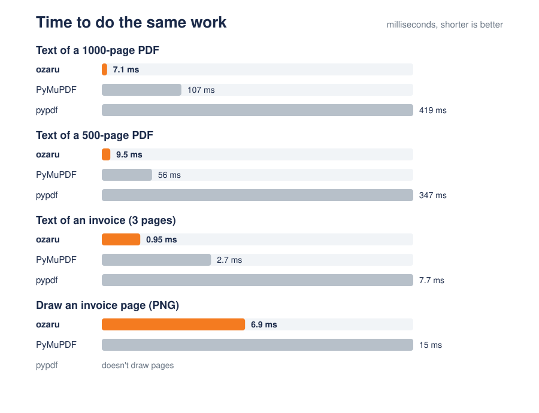

<p align="center">
  
</p>

<h1 align="center">ozaru</h1>

<p align="center"><strong>Read, draw, edit and protect PDF files from Python.<br>
Small API, Rust core, no dependencies.</strong></p>

<p align="center">
  <a href="https://pypi.org/project/ozaru/"></a>
  <a href="https://pypi.org/project/ozaru/"></a>
  <a href="https://github.com/Jair-dev57/ozaru/actions/workflows/CI.yml"></a>
  <a href="https://github.com/Jair-dev57/ozaru/blob/main/LICENSE"></a>
  <a href="https://github.com/sponsors/Jair-dev57"></a>
</p>

<p align="center">
  <a href="https://jair-dev57.github.io/ozaru/">Documentation</a> ·
  <a href="https://pypi.org/project/ozaru/">PyPI</a> ·
  <a href="https://jair-dev57.github.io/ozaru/changelog/">Changelog</a> ·
  <a href="https://github.com/sponsors/Jair-dev57">Sponsor</a>
</p>

---

```python
import ozaru

text = ozaru.extract_text("invoice.pdf")              # every word on every page
words = ozaru.extract_words("invoice.pdf")            # ...with where it is
png = ozaru.render_page("invoice.pdf", 1, scale=2)    # a page as an image
ozaru.fill_form("form.pdf", "filled.pdf", {"name": "Ana", "agree": True})
ozaru.encrypt("report.pdf", "protected.pdf", user_password="1234")
```

<p align="center">
  <picture>
    <source media="(prefers-color-scheme: dark)" srcset="https://raw.githubusercontent.com/Jair-dev57/ozaru/main/assets/speed-dark.svg">
    
  </picture>
</p>

<p align="center"><sub>Median time of one call, on an Intel Core i5-11400H.
<a href="https://jair-dev57.github.io/ozaru/reference/speed/">All the numbers</a>.</sub></p>

| | **ozaru** | PyMuPDF | pypdf |
|---|---|---|---|
| **License** | MIT | AGPL or paid | BSD |
| **Python dependencies** | none | none | none |
| **Engine** | Rust, `forbid(unsafe_code)`, fuzzed in CI | C (MuPDF) | pure Python |
| **Install** | one wheel, no compiler | one wheel | pure Python |
| **Speed** | faster than PyMuPDF at text, on par or faster drawing pages, tens of times faster than pypdf | very fast | slow on big files |
| **Draws pages** | yes | yes | no |
| **Edits** | rotate, extract, split, merge, fill forms, encrypt: more on the way | everything | pages, forms, metadata |

One function per task: you pass a path and get the result. No objects to manage, no
setup, and nothing else gets installed. Every PDF is read by **OZARU ENGINE**,
ozaru's own PDF engine: it doesn't wrap MuPDF, PDFium or any other library, and
hostile files hit limits on depth, sizes and work instead of crashing or filling your
memory. It is typed, and every error says what to fix.

ozaru is young. Its features are checked against PyMuPDF and pypdf in a public
corpus, and the road to 1.0.0 is to have everything those libraries do that matters:
see the [roadmap](design/engine.md#phases-14-and-15-own-everything-speed-and-the-rest-of-the-libraries).

## Installation

With [uv](https://docs.astral.sh/uv/), in your project:

```bash
uv add ozaru
```

To try it once, without installing anything:

```bash
uv run --with ozaru python your_script.py
```

Or into the active environment: `uv pip install ozaru`. It also installs with `pip`.
ozaru requires Python 3.10 or newer, and has wheels for Linux, macOS and Windows,
so you don't need Rust.

## Documentation

Every function, with examples and what it raises, is in the
[documentation](https://jair-dev57.github.io/ozaru/): text, words, blocks and
images; metadata and page sizes; pages as images; annotations and forms; rotate,
extract, split and merge; passwords and encryption.

## Sponsor

ozaru is built and maintained by [Jair Estupiñan](https://github.com/Jair-dev57).
If it saves you time, you can
[sponsor the project](https://github.com/sponsors/Jair-dev57): it pays for the
time that goes into the engine, the tests and the documentation.

## Contributing

You need [Rust](https://rustup.rs/) and [uv](https://docs.astral.sh/uv/). Then run:

```bash
git clone https://github.com/Jair-dev57/ozaru.git
cd ozaru
uv run pytest
```

See the [contributing guide](https://jair-dev57.github.io/ozaru/contributing/).
Bug reports and ideas are welcome in the
[issue tracker](https://github.com/Jair-dev57/ozaru/issues); for security problems,
read [SECURITY.md](SECURITY.md).

## License

ozaru is released under the
[MIT License](https://github.com/Jair-dev57/ozaru/blob/main/LICENSE).
